# Warframe LFG Board

A microservice-based "looking for group" web application for the game **Warframe**. Players browse Void Relics and crafting Resources, post group requests for the items they want to farm, and subscribe to items to get real-time notifications when someone else posts a request for them.

The project is the practical part of a master's thesis on migrating from a monolithic architecture to microservices.

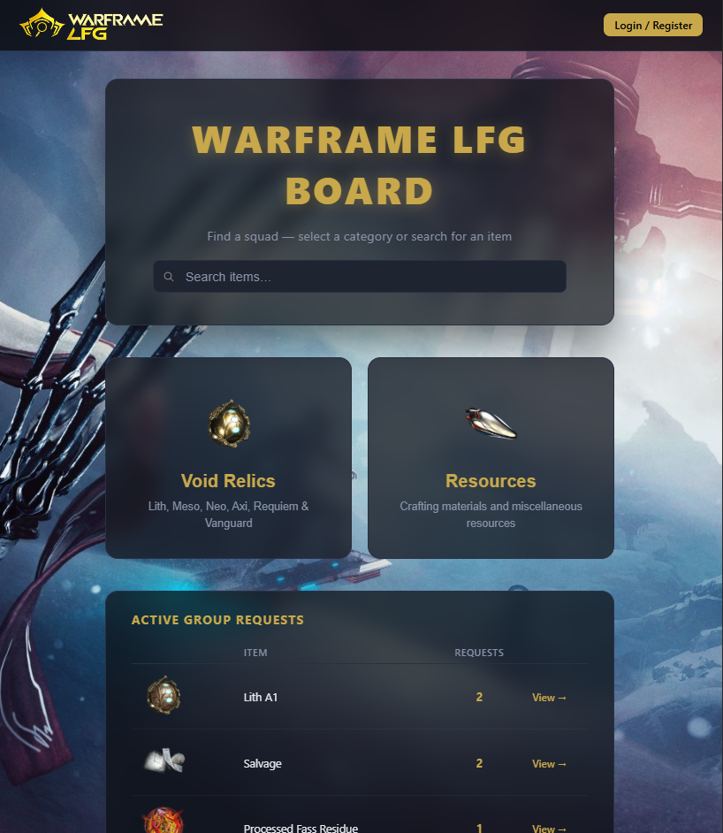

## Features

- **Item catalog** – Void Relics (Lith, Meso, Neo, Axi, Requiem, Vanguard) and Resources grouped by region and drop rarity. Relic pages show possible rewards per refinement level with drop chances. The catalog is seeded automatically on first start from the public Warframe API and the Warframe Wiki.
- **Group requests** – users post and remove requests for an item (and refinement level for relics). Free users can keep a limited number of active requests; subscribers can keep more.
- **Favorites and real-time notifications** – subscribed users favorite items and get an instant SignalR push (bell icon) when a group request is created for one of them.
- **Accounts** – registration and login with JWT, password change, in-game name lookup, monthly subscription (activate/cancel) and account deletion.
- **Admin panel** – manage relics, resources and users, review group requests and favorites, and inspect the audit log.
- **Audit trail** – every service publishes audit events to RabbitMQ and a dedicated service stores them for admins to filter and review.

## Architecture

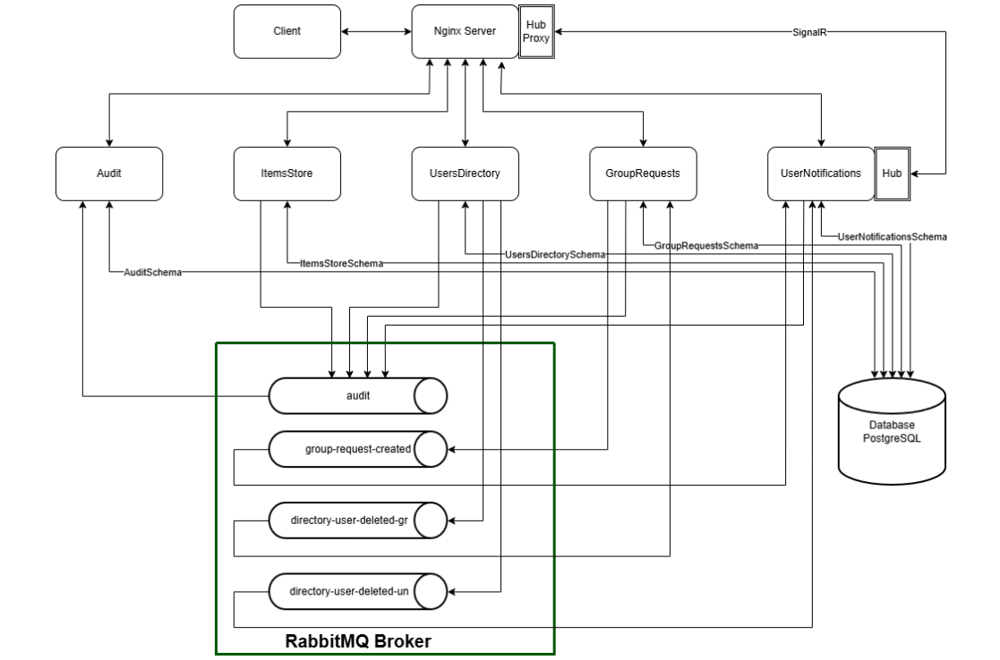

The browser talks only to **Nginx**, which serves the React build and reverse-proxies API and SignalR traffic to the services. Services never call each other over HTTP; they trust the JWT issued by `UsersDirectory` and communicate asynchronously through **RabbitMQ**. All services share one PostgreSQL instance, each with its own schema.

| Service | Port | Responsibility |
|---|---|---|
| **Frontend** (React + Nginx) | 3000 | UI, reverse proxy, SignalR hub proxy |
| **UsersDirectory** | 8001 | Identity, JWT issuing, roles, subscriptions, user administration |
| **ItemsStore** | 8002 | Relics and resources catalog, DB seeding from external sources |
| **GroupRequests** | 8003 | Group request ads and per-subscription limits |
| **Audit** | 8004 | Consumes audit events, stores and filters logs |
| **UserNotification** | 8005 | Favorites, notification storage, SignalR hub |

RabbitMQ queues:

| Queue | Publisher | Consumer |
|---|---|---|
| `audit` | ItemsStore, UsersDirectory, GroupRequests, UserNotification | Audit |
| `group-request-created` | GroupRequests | UserNotification |
| `directory-user-deleted-gr` | UsersDirectory | GroupRequests (removes the user's requests) |
| `directory-user-deleted-un` | UsersDirectory | UserNotification (removes the user's favorites and notifications) |

Public routes proxied by Nginx: `/v1/directory`, `/v1/itemstore`, `/v1/grouprequests`, `/v1/audit`, `/v1/user-notification` and the SignalR hub at `/hubs/user-notifications`.

## Tech stack

- **Backend:** .NET 10 / ASP.NET Core Web API, EF Core + Npgsql, AutoMapper, FluentValidation, JWT Bearer, SignalR, RabbitMQ.Client
- **Frontend:** React 18, TypeScript, Vite, React Router, `@microsoft/signalr`, AlertifyJS
- **Infrastructure:** PostgreSQL 16, RabbitMQ 3.13, Nginx, Docker Compose, Adminer
- **Tests:** xUnit-style unit tests for ItemsStore and GroupRequests (controllers, services, repositories, validators, seeding)

## Getting started

Prerequisites: Docker Desktop with Docker Compose.

```bash
cd webapp
docker-compose up -d --build
```

Then open:

| URL | What |
|---|---|
| http://localhost:3000 | The application |
| http://localhost:15672 | RabbitMQ management (`guest` / `guest`) |
| http://localhost:8090 | Adminer (PostgreSQL UI) |
| http://localhost:8001 – 8005 | Direct access to each service API |

On first start the database is migrated and the catalog is seeded, which can take a moment. A default administrator is created automatically:

- Email: `admin@admin.com`
- Password: `admin123`

> The credentials in `docker-compose.yml` and the seeded admin account are for local development only. Change them before deploying anywhere.

Useful commands:

```bash
docker-compose logs -f      # follow logs
docker-compose down         # stop
docker-compose down -v      # stop and delete all data
```

See [webapp/DOCKER_README.md](webapp/DOCKER_README.md) for more details and troubleshooting.

### Running the frontend without Docker

```bash
cd webapp/frontend
npm install
npm run dev
```

## Project structure

```
.
├── webapp/
│   ├── docker-compose.yml
│   ├── frontend/                 # React + Vite app, nginx.conf, Dockerfile
│   └── backend/
│       ├── UsersDirectory/
│       ├── ItemsStore/           # + ItemsStore.Tests
│       ├── GroupRequests/        # + GroupRequests.Tests
│       ├── Audit/
│       └── UserNotification/
├── docs/                         # Per-service analysis, Nginx and SignalR notes (Serbian)
│   └── images/                   # README screenshots
└── all_items.json                # Raw Warframe item data export
```

## Documentation

Detailed analysis of each component (in Serbian):

- [UsersDirectory](docs/users-directory-microservice.md)
- [ItemsStore](docs/items-store-microservice.md)
- [GroupRequests](docs/group-requests-microservice.md)
- [UserNotification](docs/user-notification-microservice.md)
- [Audit](docs/audit-microservice.md)
- [Nginx](docs/nginx-analysis.md)
- [SignalR](docs/signalr-analysis.md)

## Screenshots

### Catalog

| Relics | Resources |
|---|---|
| 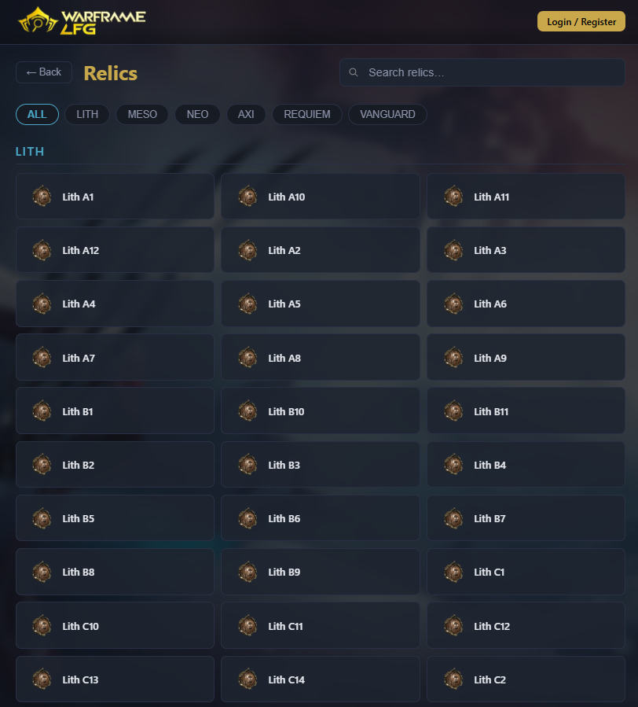 | 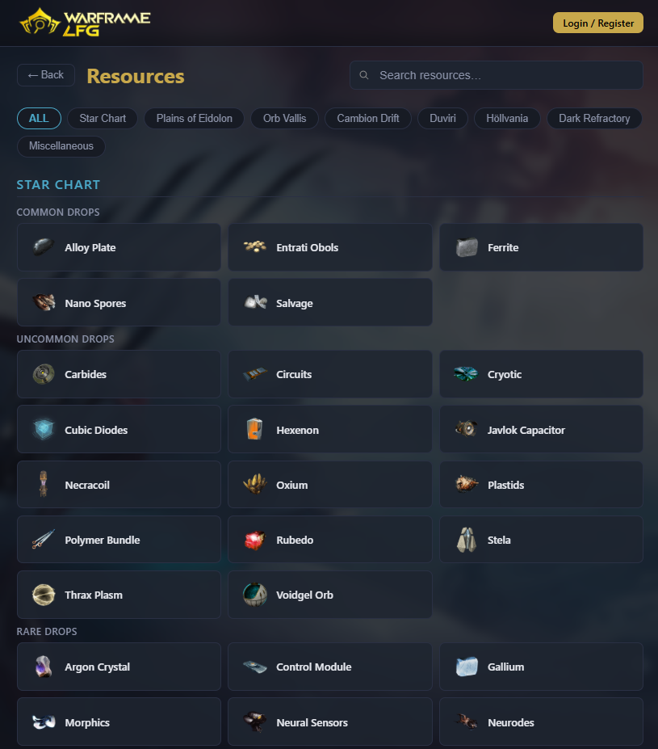 |

### Relic details and group requests

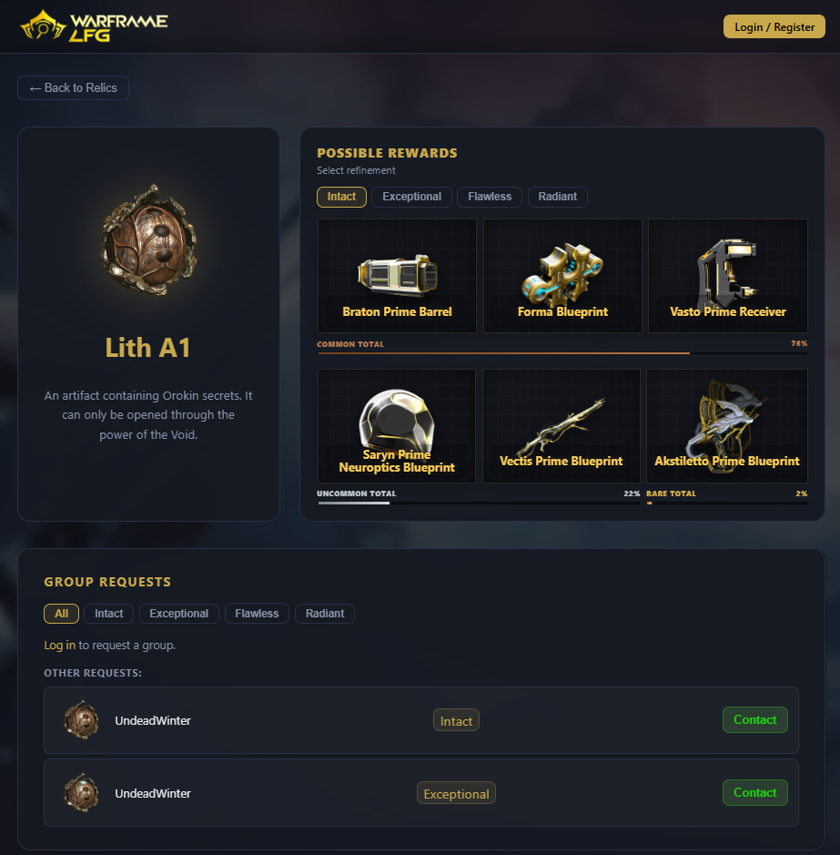

| Group requests (own and others') | Item with favorite button |
|---|---|
| 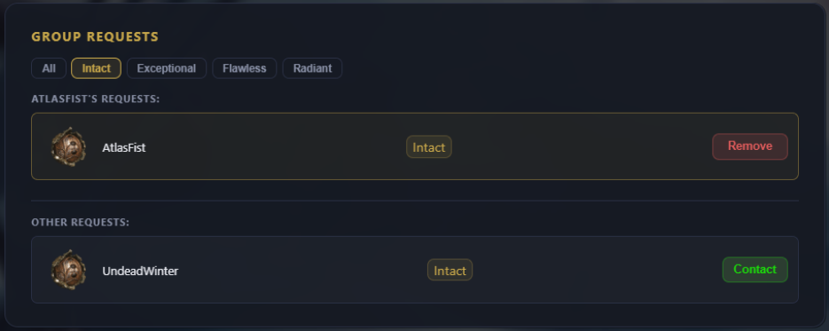 | 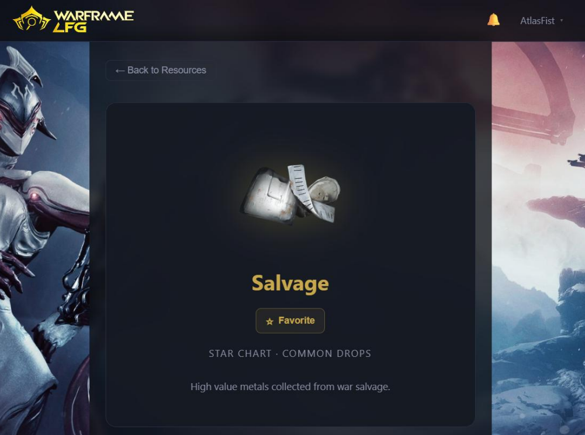 |

### User area

| My group requests | Notifications |
|---|---|
| 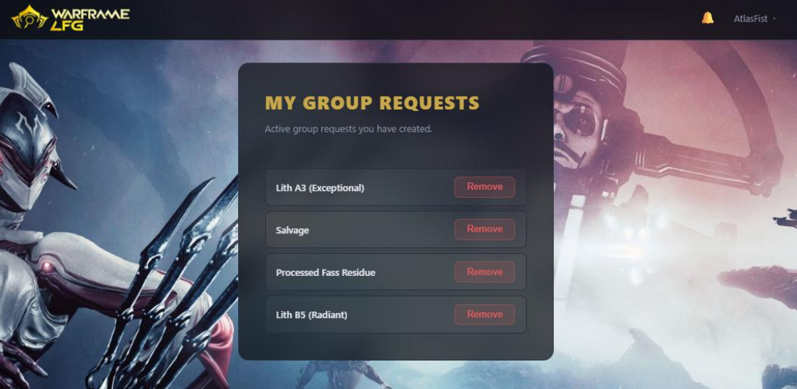 | 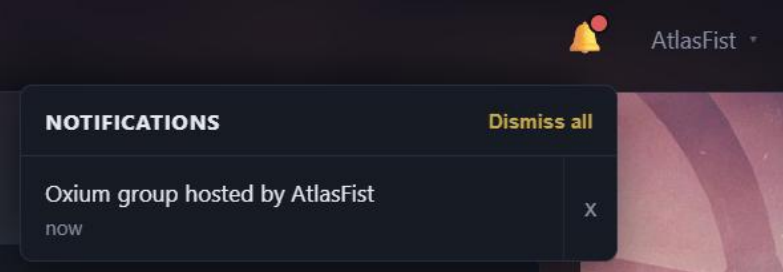 |

| Account settings | Subscription and account deletion |
|---|---|
| 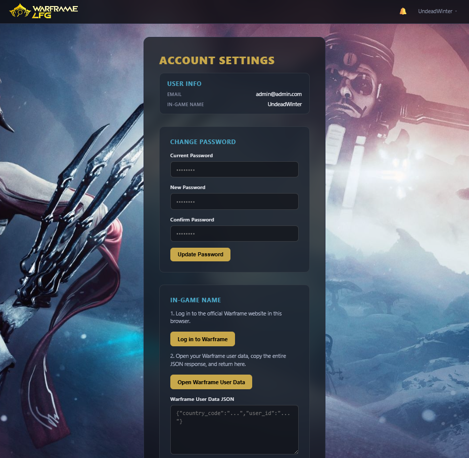 | 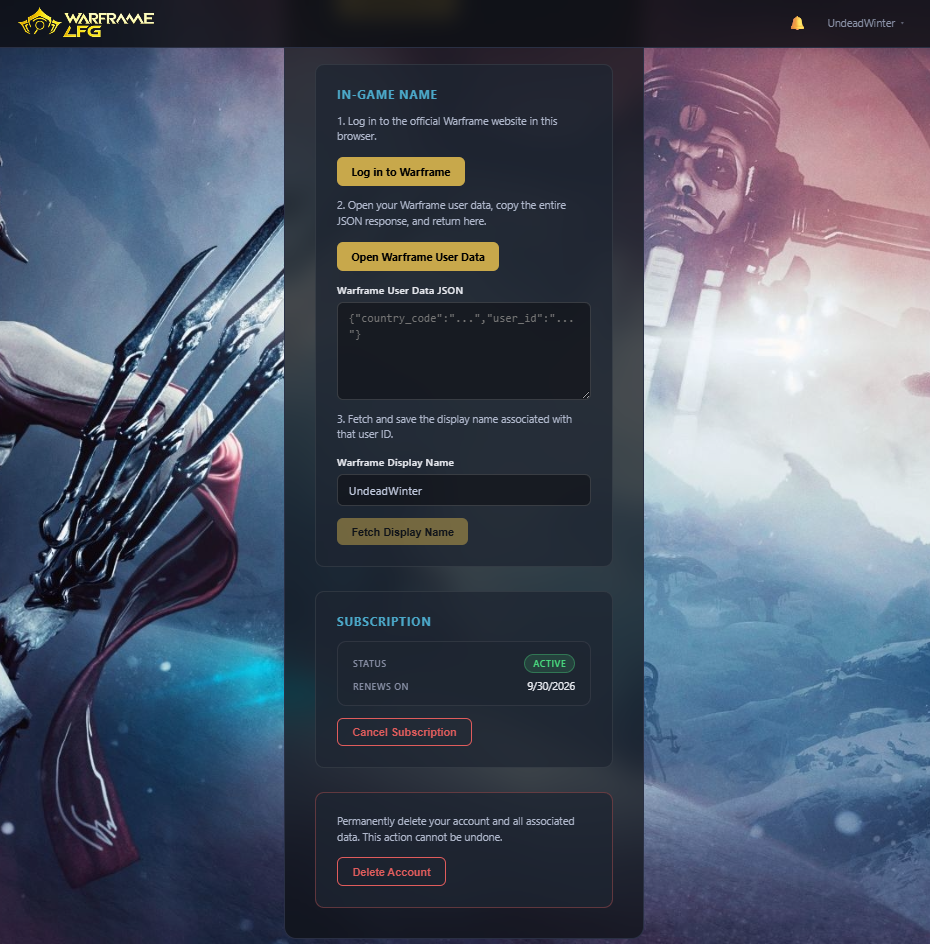 |

### Admin panel

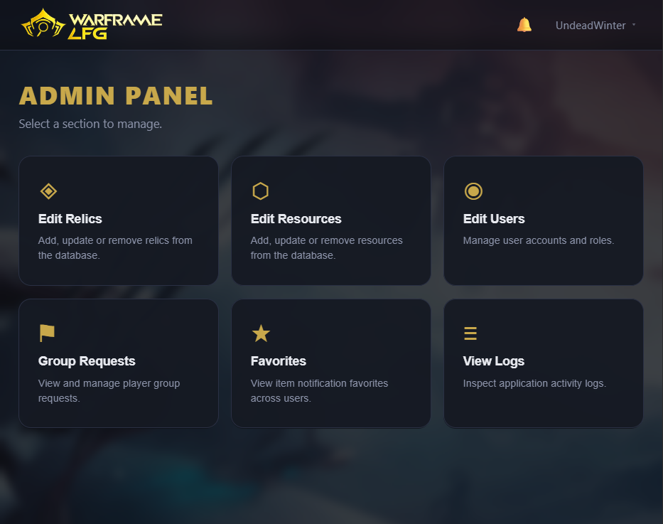

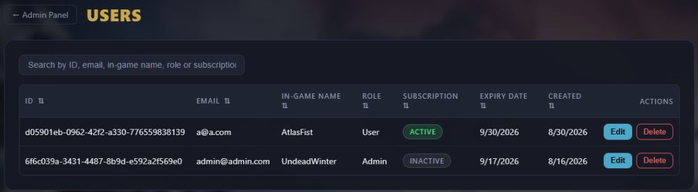

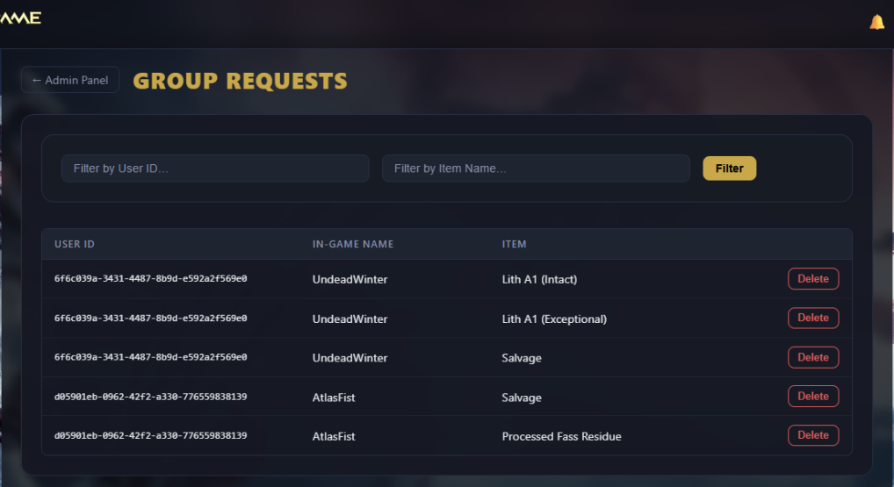

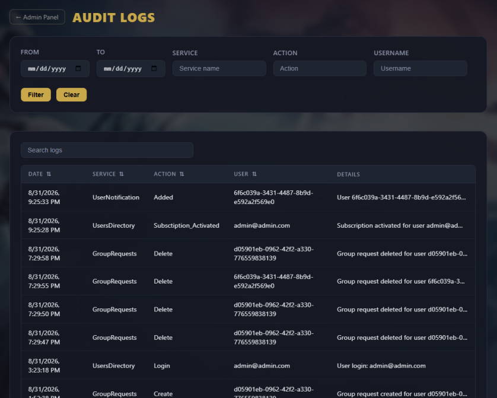

## Author

Vladimir Jankovic – master's thesis project.
