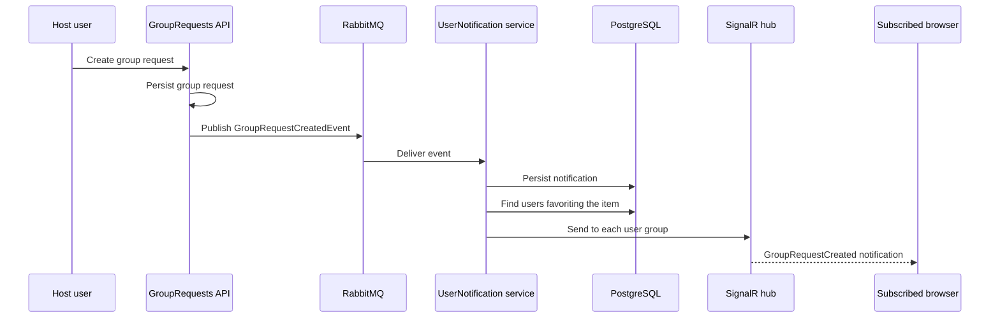

# SignalR Use and Functionality Analysis

## Executive summary

SignalR is used for one focused feature: delivering real-time notifications when a new group request is created for an item that a user has marked as a favorite.

It is part of a larger delivery chain rather than being called directly by the Group Requests service:



The implementation works well for the current single-instance Docker deployment. It authenticates hub connections, isolates delivery by user, supports multiple connections per user, and persists notifications so the UI can retrieve recent events over REST. Its main weaknesses are JWT exposure through WebSocket query-string logging, incomplete recovery for missed live messages, at-least-once duplicate behavior, and lack of a scale-out backplane.

## Main components

| Component | Responsibility |
|---|---|
| [`GroupRequestsService`](../webapp/backend/GroupRequests/GroupRequests/Services/GroupRequestsService.cs) | Publishes a `GroupRequestCreatedEvent` after creating a group request. |
| [`NotificationEventConsumer`](../webapp/backend/UserNotification/UserNotification/Broker/RabbitMQ/NotificationEventConsumer.cs) | Consumes RabbitMQ events, persists notifications, finds recipients, and invokes SignalR. |
| [`UserNotificationHub`](../webapp/backend/UserNotification/UserNotification/Hubs/UserNotificationHub.cs) | Authenticates connections and assigns each connection to a user-specific group. |
| [`Program.cs`](../webapp/backend/UserNotification/UserNotification/Program.cs) | Registers SignalR, configures JWT extraction, and maps the hub endpoint. |
| [`notificationsApi.ts`](../webapp/frontend/src/api/notificationsApi.ts) | Creates the SignalR client, supplies the JWT, and defines the event contract. |
| [`NavBar.tsx`](../webapp/frontend/src/components/NavBar.tsx) | Starts/stops the connection and renders incoming notifications. |
| [`nginx.conf`](../webapp/frontend/nginx.conf) | Proxies the hub and enables WebSocket upgrades. |

## Backend registration and endpoint

The User Notification service registers SignalR with:

```csharp
builder.Services.AddSignalR();
```

It maps `UserNotificationHub` to:

```text
/hubs/user-notifications
```

The hub is decorated with `[Authorize]`, so anonymous clients cannot establish a connection. There are no client-callable hub methods; communication is currently one-way from the server to the browser.

## Authentication

The React client supplies the JWT through `accessTokenFactory`:

```typescript
.withUrl('/hubs/user-notifications', {
  accessTokenFactory: () => localStorage.getItem('auth_token') ?? '',
})
```

For browser WebSocket and Server-Sent Events transports, SignalR may place this token in the `access_token` query parameter. The backend's `JwtBearerEvents.OnMessageReceived` handler accepts that query parameter only when the request path belongs to the notification hub. Normal API authentication continues to use the bearer header.

After token validation, the hub reads `ClaimTypes.NameIdentifier`. The Users Directory service issues the user ID as the JWT `sub` claim, relying on the JWT handler's inbound claim mapping to expose it as `NameIdentifier`.

### Security implications

- The hub is authenticated, and users cannot choose which user group they join.
- Group names are constructed on the server as `user:{userId}`.
- In the present HTTP-only deployment, the token can travel without transport encryption. Production use requires HTTPS/WSS.
- Nginx's normal access log contains the complete request line. A WebSocket URL containing `access_token` can therefore leak the JWT into container logs unless hub request logging is disabled or redacted.
- Storing the JWT in `localStorage` makes it accessible to JavaScript and therefore vulnerable if an XSS flaw is introduced elsewhere in the frontend.

## User-specific SignalR groups

When a connection succeeds, `OnConnectedAsync` adds its connection ID to a group named after the authenticated user:

```csharp
await Groups.AddToGroupAsync(
    Context.ConnectionId,
    $"user:{userId}");
```

This design has useful behavior:

- A notification can target a user without tracking connection IDs in application code.
- Multiple browser tabs or devices belonging to the same user all receive the event.
- SignalR automatically removes disconnected connections, so a custom `OnDisconnectedAsync` implementation is unnecessary.
- A reconnected client receives a new connection ID and is added back to its user group when the connection is re-established.

The group is only an in-memory routing mechanism. Group membership is not persisted across server restarts and is local to a SignalR server instance unless a backplane or managed SignalR service is added.

## Event production

After the Group Requests service stores a new request, it publishes a `GroupRequestCreatedEvent` to the durable RabbitMQ queue `group-request-created`.

The event contains:

- ID of the user who created the group request.
- Item name.
- Creator's in-game name.
- Creation timestamp.

The queue is durable and the message is marked persistent. This decouples the Group Requests API from the notification service and allows events to wait in RabbitMQ while the consumer is temporarily unavailable.

The API intentionally catches publishing failures and still returns the successfully created group request. This preserves the main operation but means a broker outage can permanently lose its notification because there is no transactional outbox or retry record in the Group Requests database.

## RabbitMQ-to-SignalR bridge

`NotificationEventConsumer` runs as a hosted background service inside the User Notification process. It consumes one unacknowledged message at a time using RabbitMQ prefetch count `1`.

For each event it:

1. Creates a persisted notification in PostgreSQL.
2. Queries favorites to find user IDs subscribed to the event's item.
3. Builds the frontend notification payload.
4. Sends `GroupRequestCreated` to each recipient's `user:{id}` SignalR group.
5. Acknowledges the RabbitMQ message after persistence and all SignalR sends complete.

The payload is:

```typescript
interface GroupRequestNotification {
  id: string
  groupRequestUserId: string
  itemName: string
  inGameName: string
  createdAt: string
}
```

Sending to a group with no connected clients is valid and completes without an error. The notification remains in PostgreSQL for the REST recovery path.

## Favorites and recipient selection

SignalR delivery is not broadcast globally. The consumer looks up every user whose favorites contain the exact `ItemName` from the event and sends only to those user groups.

Adding a favorite requires a JWT containing `subscription_status=Active`. However, live recipient selection only checks the favorites table; it does not revalidate the recipient's current subscription status. Inactive users' favorites are deleted when they request pending notifications, but stale favorites can remain until that REST call occurs.

The creator is not excluded from recipient selection. If the creator has also favorited the same item, the creator can receive a notification about their own group request.

## Frontend connection lifecycle

The Navbar creates the connection only when a user is logged in. It then:

1. Fetches recent pending notifications through the REST API.
2. Creates a `HubConnection` using the current JWT.
3. Registers a handler for `GroupRequestCreated`.
4. Starts the connection.
5. Adds new payloads to the top of the notification list, ignoring duplicate IDs already in UI state.
6. Stops the connection when the user logs out, the authentication identity changes, or the component unmounts.

`withAutomaticReconnect()` handles interruptions to an already established connection. It does not continuously retry a failed initial `start()`. The current initial-start error is swallowed, so another attempt occurs only after an authentication/page lifecycle change.

The client does not register `onreconnecting`, `onreconnected`, or `onclose` callbacks. Consequently, it does not expose connection state to the user or refetch persisted notifications after reconnecting.

## Persistent notification fallback

SignalR is complemented by authenticated REST endpoints:

```text
GET  /v1/user-notification/notifications
POST /v1/user-notification/notifications/{id}/dismiss
```

Pending notification retrieval filters the persisted event stream using:

- The requesting user's current favorites.
- Per-user dismissal records.
- A recent time window, five minutes by default.
- Active subscription status from the JWT.

A background cleanup service deletes expired notifications once per minute. This means persistence is a brief recovery window, not long-term notification history.

This hybrid design is stronger than SignalR-only delivery because a user loading the page shortly after an event can still see it. However, the client fetches pending notifications only on initial authenticated setup. Events missed during a later disconnect are not automatically reconciled when SignalR reconnects.

## Nginx and development proxying

The production-style frontend container proxies `/hubs/user-notifications` to `user-notification:8080`. Its dedicated Nginx block:

- Uses HTTP/1.1.
- Forwards `Upgrade` and `Connection: upgrade`.
- Preserves the host, client IP, forwarded chain, and scheme headers.
- Uses one-hour read and send timeouts for long-lived connections.

When using Vite's development server, [`vite.config.ts`](../webapp/frontend/vite.config.ts) mirrors this route and enables `ws: true`, targeting `localhost:8005`.

Because both configurations expose the hub under the frontend's origin, the browser uses a relative URL and does not require cross-origin SignalR/CORS configuration.

## Delivery semantics and failure modes

### Duplicate notifications

The consumer acknowledges an event only after database insertion and SignalR sending. If processing fails after insertion but before acknowledgement, RabbitMQ requeues the event. Retrying creates another database notification with a new ID and can send the same logical event again.

The frontend only deduplicates by notification ID, so it cannot recognize these as duplicates. The event has no stable event ID and the database has no corresponding uniqueness constraint. Delivery is therefore effectively at least once, without idempotent processing.

### Poison-message loop

Deserialization failures and processing exceptions are negatively acknowledged with `requeue: true`. A permanently malformed or invalid message can be retried indefinitely, blocking useful work because the consumer prefetches only one message. There is no dead-letter queue or retry limit.

### Missed live notifications

A client can miss an event during:

- The gap between its initial REST fetch and successful hub connection.
- A connection interruption.
- A failed initial connection.
- A User Notification service restart.

The database may still contain the event, but the frontend does not refetch after reconnect. A page reload within the retention window usually recovers it.

### Horizontal scaling

The current design assumes one User Notification instance. With multiple instances:

- SignalR groups and connections exist only in the instance handling each socket.
- RabbitMQ sends a queue message to one competing consumer instance.
- That instance can push only to clients connected to itself.

Clients connected to other instances would miss the live message. Scale-out requires a SignalR backplane such as Redis, Azure SignalR Service, or an event topology that delivers every notification event to every SignalR instance. Sticky sessions alone do not solve event distribution.

### Publisher reliability

Durable queues and persistent messages improve broker-side durability, but the producer does not use a transactional outbox. The inspected publisher also does not explicitly enable publisher confirms. There is a possible consistency gap between committing a group request and successfully publishing its notification event.

## Strengths

- SignalR is limited to a clear use case rather than mixed with business persistence.
- Authentication is enforced at the hub boundary.
- User groups prevent global notification broadcasts.
- Multiple connections per account are supported naturally.
- RabbitMQ decouples event production from real-time delivery.
- Notifications are stored before live sending.
- REST retrieval and per-user dismissal provide a useful fallback.
- Nginx and Vite both support the required WebSocket route.
- The frontend cleans up connections on logout and component disposal.
- Event names and the hub route are constants on the backend.

## Recommended improvements

Recommended in priority order:

1. **Require HTTPS/WSS and protect query-string tokens.** Redact or disable Nginx access logging for the hub route so JWT query parameters are never written to logs.
2. **Reconcile after reconnect.** Register `onreconnected` and fetch pending notifications again. Also implement controlled retries for a failed initial `start()`.
3. **Make event processing idempotent.** Add a stable event ID, store it with a unique constraint, and treat a redelivery as already processed.
4. **Add dead-letter handling.** Limit retries and route poison messages to a dead-letter queue instead of requeueing forever.
5. **Use an outbox and publisher confirms.** Close the consistency gap between group-request persistence and RabbitMQ publication.
6. **Plan SignalR scale-out before adding replicas.** Add a Redis backplane or managed SignalR service and verify proxy/load-balancer affinity requirements.
7. **Enforce current subscription eligibility consistently.** Avoid relying only on possibly stale JWT claims or cleanup triggered by the pending-notification endpoint.
8. **Decide whether self-notifications are intended.** Exclude the event creator from recipients if they should not be notified about their own request.
9. **Expose connection state.** Use reconnect/close callbacks for logging, observability, and optional UI status.
10. **Use strongly typed hub contracts.** A typed `Hub<TClient>` interface would reduce the risk of backend event-name or payload drift, although TypeScript still needs a shared/generated contract strategy.

## Overall assessment

SignalR is integrated coherently into the project's notification workflow. It handles the final, real-time delivery step while RabbitMQ handles cross-service communication and PostgreSQL provides a short recovery window. For a single User Notification container, the basic functionality is sound.

The most important production concerns are secure token transport/logging, reconnect reconciliation, idempotent RabbitMQ consumption, and horizontal scale-out. Addressing those areas would turn the current functional implementation into a substantially more reliable real-time notification subsystem.
